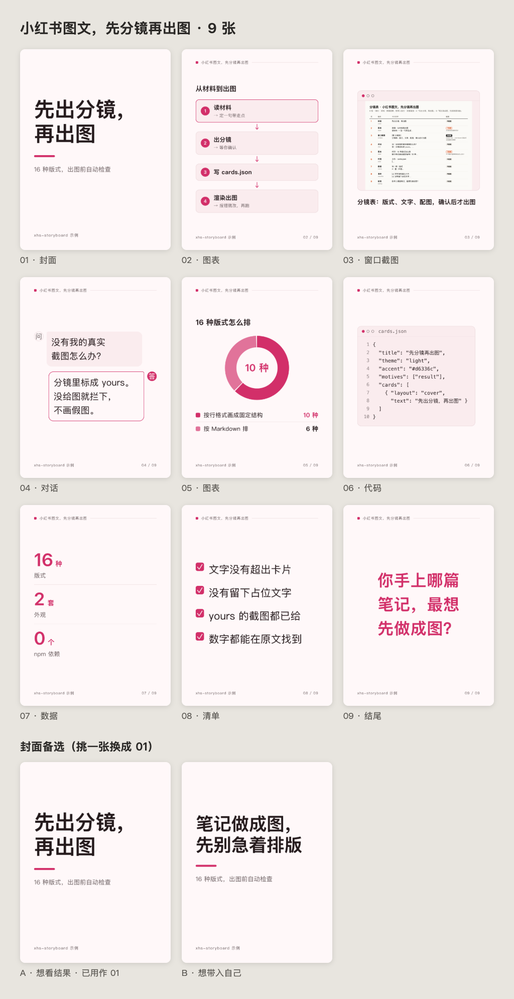

# Hidevinliu · 小红书分镜出图

一个给 Claude Code / Codex 用的 Skill：把文章、笔记、文档做成一组小红书图文（3:4，每张 1080×1440 PNG）。先出分镜表，确认后再出图；出图前自动检查，有问题就不出图。

版本 0.2.0：新增「图表」版式（配图来源 `draw`，代码画），柱状、折线、环形、流程、对比、矩阵、时间轴 7 种图由脚本自己的代码画成 SVG，图里的数字同样要在原文里找得到。



上图是 `examples/intro/` 的成品：一篇介绍这个 Skill 的说明文（`source.md`）→ 分镜（`cards.json`）→ 9 页加 2 张封面备选。第 2、5 页是代码画的图表（流程、环形），第 3 页里的截图是 `render.mjs --storyboard` 画出的这组图自己的分镜表。

## 和别的图文 Skill 不一样的地方

1. **互动动机钩子**：分镜时先选 1–2 个读者参与的动机（想纠正你 / 想看结果 / 想看翻车 / 想辨真伪 / 想给你支招 / 想带入自己 / 想证明自己），封面和结尾围绕它写。每个动机有底线，能查的脚本都查：定了动机，最后一页必须用问题收尾；「想辨真伪」必须在结尾前揭晓答案；任何一页都不许故意埋错引人纠正。
2. **数字溯源**：给了原文（`source.md`），卡片、标题、封面上的每个阿拉伯数字都要在原文里找得到，找不到就报错、不出图，并列出是哪一页的哪个数字。全角数字、千分位逗号都会先统一再比对。
3. **封面多版本**：`covers` 里写 2–3 个不同动机的封面，各出一张 `cover-a.png`、`cover-b.png`，总览图里并排放，挑一张用。
4. **一个颜色出整套配色**：只给一个主色，脚本在 OKLCH 色彩空间里推出底色、正文、辅助文字、分隔线、代码底色，再按 WCAG 2 算对比度；正文、辅助文字、主色任何一项在底色上低于 4.5:1，就自动调深或调浅，并打印改了什么。

另外：16 种版式（含窗口截图、手机截图、代码、提示词、对话、数据、对错、时间线、清单、图表）、两套外观（浅色「简约」、深色「极客」）、内容少的结构化卡片自动放大填满、文字溢出 / 残留「待补」占位 / 该给的真实截图没给都会拦下，绝不画假截图。

## 安装

需要 Node.js 18 及以上，和本机的 Google Chrome / Chromium（Edge 也可以）。没有任何 npm 依赖，不用 `npm install`。

把整个文件夹复制进 Skill 目录，文件夹名就是 Skill 名：

```bash
# Claude Code
cp -R xhs-storyboard ~/.claude/skills/hidevinliu-xhs-storyboard
# Codex 或其它读 ~/.agents/skills 的工具
cp -R xhs-storyboard ~/.agents/skills/hidevinliu-xhs-storyboard
```

Chrome 装在非默认位置时，设环境变量 `CHROME_PATH`，或渲染时加 `--chrome /path/to/chrome`。Linux 上需要装中文字体（如 `fonts-noto-cjk`），否则中文会显示成方块。

## 怎么用

在 Claude Code / Codex 里直接说：

- 「把这篇文章做成小红书图文：`notes/xxx.md`」
- 「用小红书分镜出图，把下面这段笔记做成 6 页，深色极客风，主色 #2563eb」
- 「先给我看分镜表，动机用想看结果」

它会先给你一张分镜表（页、版式、文字、配图来源、动机、封面备选），你确认或修改后，它写 `cards.json` 并运行：

```bash
node scripts/render.mjs path/to/cards.json            # 输出到 cards.json 旁边的 out/
node scripts/render.mjs path/to/cards.json --storyboard  # 只把分镜表画成图
```

成功时输出 `01.png … NN.png`、`cover-a.png …`、`overview.png` 和 `check.json`，退出码 0；有错误时只写 `check.json` 并逐条说明怎么改，退出码 1。字段说明见 [references/cards-json.md](references/cards-json.md)。

## 16 种版式

| 版式 | 名称 | 用途 | 写法 |
|---|---|---|---|
| `cover` | 封面 | 第 1 张大字 | 一句话，≤16 字 |
| `statement` | 一句话 | 一个观点 | 一段话，≤40 字 |
| `list` | 要点 | 3–5 条并列要点 | 「- 」开头，每条 ≤18 字 |
| `steps` | 步骤 | 有先后的 3–5 步 | 「1. 」开头，每步 ≤18 字 |
| `compare` | 对比表 | A vs B | 两列 Markdown 表格，≤4 行 |
| `window` | 窗口截图 | 电脑界面真实截图 | `` + 一句说明 |
| `phone` | 手机截图 | 手机界面真实截图 | `` + 一句说明 |
| `code` | 代码 | 代码或命令 | 首行可写「文件：xxx」，≤12 行 |
| `prompt` | 提示词 | 可复制的提示词 | 原文，≤120 字 |
| `chat` | 对话 | 一问一答 | 「问：」「答：」开头 |
| `metric` | 数据 | 1–3 个关键数字 | 「数字｜单位｜说明」 |
| `rightwrong` | 对错 | 对的和错的做法 | 「✓ 」「✗ 」开头 |
| `timeline` | 时间线 | 按时间的 3–5 件事 | 「时间｜事件」 |
| `checklist` | 清单 | 照着打勾 | 「[x] 」「[ ] 」开头 |
| `chart` | 图表 | 原文里真有的数据或结构，代码画 | 首行写类型（柱状 / 折线 / 环形 / 流程 / 对比 / 矩阵 / 时间轴），下面每行一项 |
| `ending` | 结尾 | 最后一张，问题收尾 | 一句话，≤40 字 |

每种的示例和上限见 [references/layouts.md](references/layouts.md)。

## 渲染方式

`scripts/render.mjs` 用 `--headless=new --remote-debugging-pipe` 启动一次本机 Chrome，经管道（不开网络端口）用 DevTools 协议驱动：打开一张由 `assets/render.html`、`assets/cards.css`、`assets/cards.js` 拼成的临时页面，等排版脚本返回结果（Promise，而不是猜一个等待时间），再按 1080×1440 精确裁切截图。比起每页启动一次 Chrome 的 `--screenshot` 命令行方式，这样只启动一次、能拿到检查结果、截图尺寸确定，也只用 Node 自带的模块，Node 18 就能跑。

`assets/cards.js` 是一个 ES 模块：解析、校验、配色、检查这些纯函数在 Node 里测试和调用，排版函数在页面里运行。测试：`node --test scripts/*.test.mjs`（装了 Chrome 时会在临时目录里完整渲染一遍示例）。

## 许可证

MIT，见 [LICENSE](LICENSE)。

---

## English

**Hidevinliu · XHS storyboard** (v0.2.0) is a Claude Code / Codex skill that turns an article or notes into a Xiaohongshu (RedNote) 3:4 carousel of 1080×1440 PNGs. It drafts a storyboard first (page, layout, copy, picture source, audience motive, cover variants), waits for your confirmation, then writes `cards.json` and renders it with your local Chrome.

What it adds: audience-motive hooks with enforced bottom lines (the set must end on a question; a "verify" set must reveal the answer; no planted mistakes), number provenance (every Arabic numeral on the cards must appear in the source, or the render fails), 2–3 cover variants rendered side by side, and a full palette derived from one accent colour in OKLCH with WCAG contrast auto-fixed to 4.5:1. 16 layouts (including code-drawn charts: bar, line, donut, flow, compare, 2×2 matrix, timeline — our own SVG renderer, no chart library, every number traced to the source), a light and a dark look, overflow / placeholder / missing-screenshot checks, and it never fakes a screenshot.

Install: copy this folder to `~/.claude/skills/hidevinliu-xhs-storyboard` (or your Codex skills folder). Requires Node.js 18+ and Chrome/Chromium; zero npm dependencies. Run `node scripts/render.mjs path/to/cards.json`. Exit code 0 means every check passed; 1 means fix the listed problems; 2 means a setup problem (file or Chrome not found).

License: MIT © 2026 Devin Liu.
